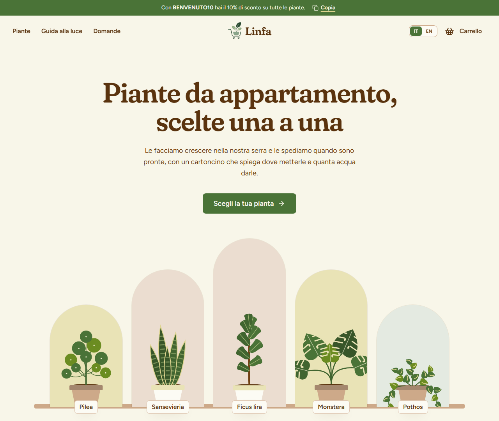
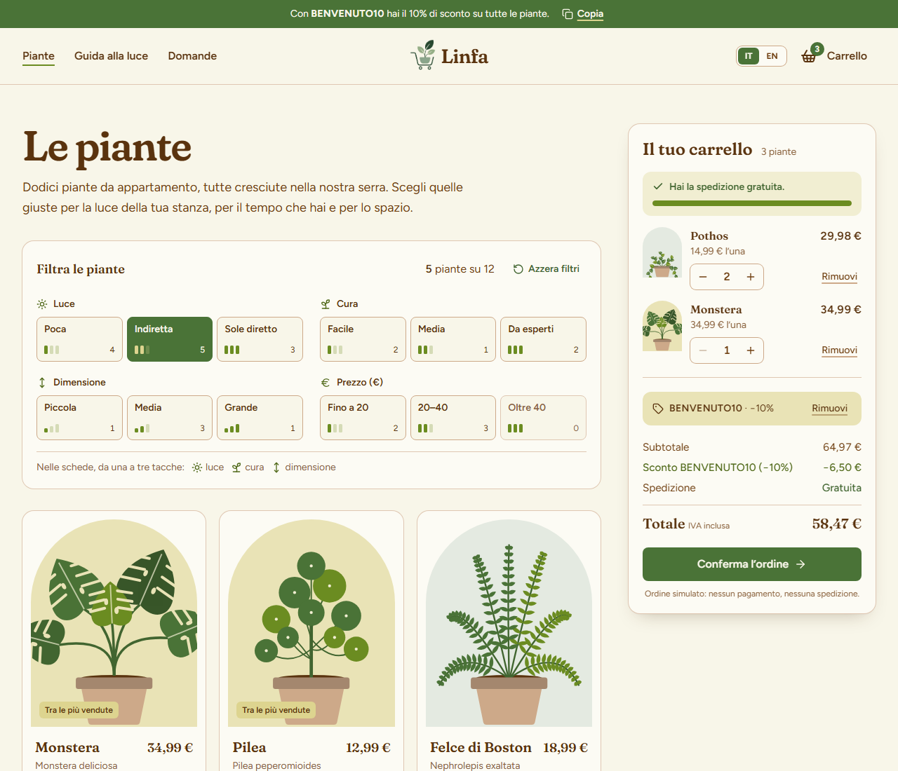
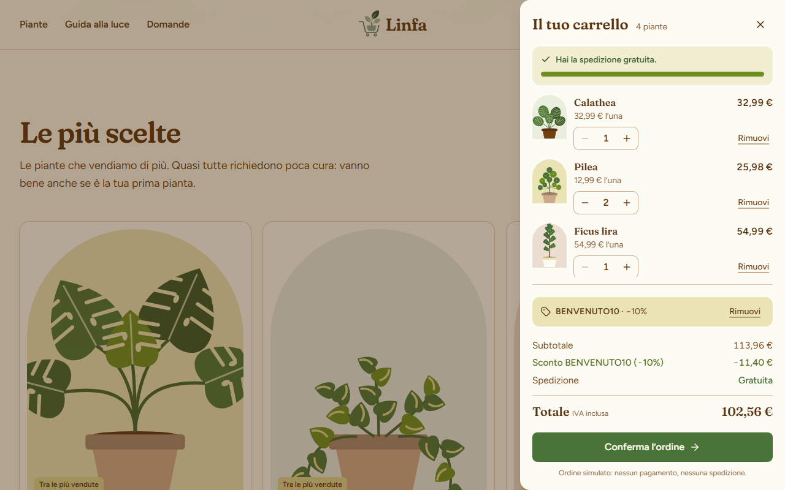
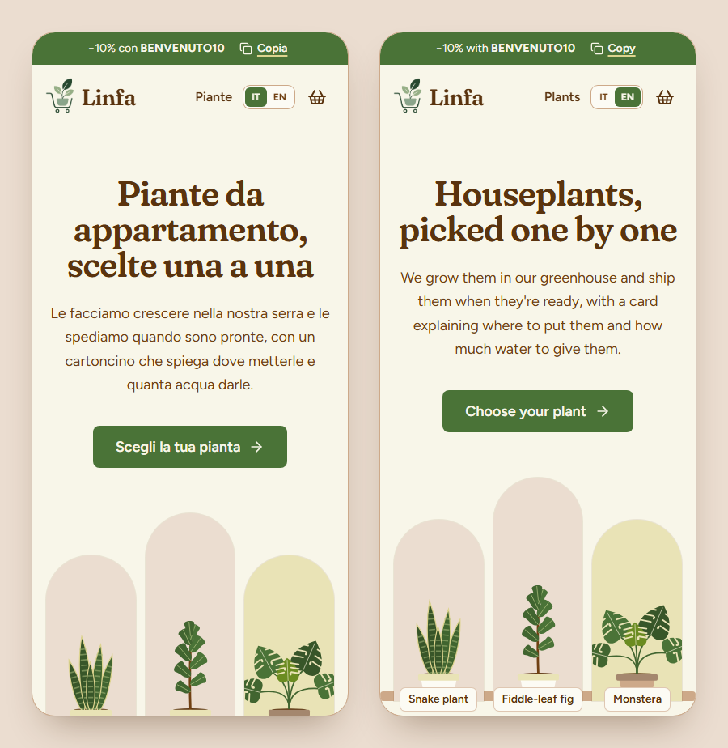

# Linfa

Negozio online di piante da appartamento, immaginario, con **catalogo filtrabile, carrello e ordine simulato**. Ha due pagine, la home e il catalogo, in italiano e inglese, con uno stile «serra» su fondo crema.



**Demo online:** il sito è pubblicato con GitHub Pages; il link è nella sezione *About* di questo repository.

> **Progetto dimostrativo.** Il negozio non esiste: email e telefono sono fittizi e non c'è un backend. Codici sconto e ordini passano da una API simulata, nessun pagamento viene richiesto e nessuna pianta parte davvero. Carrello e ordini restano salvati solo nel browser di chi visita il sito.

## Funzionalità

- **Catalogo** di 12 piante con prezzo, nome botanico e tre cartellini: luce, cura e dimensione.
- **Filtri combinabili** per luce, cura, dimensione e fascia di prezzo. Ogni opzione mostra quante piante troverebbe. I filtri stanno nella query string (`/piante?luce=1&prezzo=oltre-40`), quindi si possono condividere e sopravvivono al tasto indietro.
- **Guida alla luce** in home: scegli quanta luce ha la tua stanza e vedi le piante adatte, con un link al catalogo già filtrato.
- **Carrello** sempre visibile accanto al catalogo su desktop e a scomparsa altrove. Ha le quantità (da 1 a 10), la rimozione con «Annulla» e la barra della spedizione gratuita (da 49,99 €). I totali scorrono quando cambiano. Il carrello resta salvato nel browser ed è allineato tra più schede aperte.
- **Codice sconto** `BENVENUTO10` (10%), controllato dall'API simulata. Mentre viene verificato, il pulsante mostra «Verifica…». I codici sbagliati mostrano un errore.
- **Ordine simulato**: «Conferma l'ordine» mostra «Invio dell'ordine…», poi la conferma con il numero d'ordine, il totale e il giorno di consegna previsto. Il carrello si svuota.
- **Italiano e inglese** con un selettore nell'header. La scelta resta salvata nel browser.
- **Responsive**, da 320px in su.
- **Accessibile**: contrasti WCAG AA, annunci per i lettori di schermo a ogni modifica del carrello, animazioni ridotte con «riduci movimento» attivo nel sistema.

| Catalogo con filtri e carrello | Carrello aperto con codice sconto |
|---|---|
|  |  |



## Tecnologie

[React 19](https://react.dev) · [TypeScript](https://www.typescriptlang.org) · [Vite](https://vite.dev) · [React Router](https://reactrouter.com) · [Tailwind CSS 4](https://tailwindcss.com) · [i18next](https://www.i18next.com) · [Motion](https://motion.dev) · [Lucide](https://lucide.dev) · [oxlint](https://oxc.rs)

## Avvio

Serve [Node.js](https://nodejs.org) 20.19+ o 22.12+.

```bash
npm install
npm run dev      # server di sviluppo su http://localhost:5173
npm run build    # controllo dei tipi + build di produzione in dist/
npm run preview  # serve la build di produzione
npm run lint     # oxlint
```

Per aprire il sito direttamente in una lingua: `http://localhost:5173/?lng=en`.

## Come funzionano le azioni simulate

`src/api/checkout.ts` imita un piccolo backend con due funzioni asincrone. Ognuna attende 0,6 secondi per simulare la rete. Nessuna chiamata esce dal browser.

- `validateDiscountCode(input)` restituisce il codice valido. Maiuscole e spazi non contano. Se il codice non esiste fallisce con `InvalidCodeError`.
- `submitOrder({ lines, code })` registra l'ordine e restituisce la conferma. Come farebbe un server vero, non si fida del browser: ricalcola i totali con i prezzi del catalogo e ricontrolla il codice. Se non ci sono piante valide fallisce con `EmptyOrderError`. Se il codice non è valido fallisce con `InvalidCodeError`: il carrello toglie il codice, aggiorna il totale e chiede di confermare di nuovo.

Altri dettagli:

- **numero d'ordine**: ha la forma `LNF-AAMMGG-NNN`, progressivo nella giornata. Prima di quelli del visitatore ci sono da 18 a 57 ordini di altri clienti (simulati), scelti con un generatore pseudocasuale che usa la data come seme: lo stesso giorno parte sempre dallo stesso numero;
- **consegna prevista**: la pianta parte il giorno dopo l'ordine e arriva entro 48 ore. Se la data cade di domenica, slitta al lunedì;
- **dove restano i dati**: gli ordini nel `localStorage` alla chiave `linfa:ordini`, il carrello in `linfa:carrello`. Se il `localStorage` non è disponibile, per esempio in navigazione privata con lo storage bloccato, i dati restano in memoria fino al ricaricamento della pagina. Per ricominciare da zero basta eliminare queste chiavi dagli strumenti per sviluppatori del browser (Application → Local Storage).

Il carrello in sé non passa dall'API: come quello di un ospite in un negozio vero, vive nel browser. Le regole stanno in `src/cart/cart.ts`: reducer, totali, lettura e scrittura. In memoria si salvano solo slug e quantità: prezzi e nomi si leggono sempre dal catalogo. In lettura si scartano le piante sconosciute e le quantità si riportano tra 1 e 10. Tutti gli importi sono in centesimi.

## Struttura

```
src/
  main.tsx                 punto di ingresso: stile, i18n, router e App
  App.tsx                  rotte: / (home) e /piante (catalogo)
  LinfaLayout.tsx          header, pagina, footer e carrello a scomparsa
  linfa.css                Tailwind con il tema del negozio (palette, font, ombre)
  api/
    checkout.ts            API simulata: codice sconto e invio dell'ordine
    mock.ts                attesa simulata, localStorage con ripiego in memoria, generatore pseudocasuale
  assets/logo.webp         logo (header e footer)
  cart/
    cart.ts                regole del carrello (reducer, totali, salvataggio)
    CartContext.ts         tipi e hook useCart
    CartProvider.tsx       stato del carrello, azioni e annunci per i lettori di schermo
    useRecentlyAdded.ts    ultima pianta aggiunta, per gli avvisi
  components/
    LinfaHeader.tsx        striscia del codice, link, logo, selettore di lingua e carrello
    LinfaFooter.tsx        link, contatti e note legali
    LanguageSwitch.tsx     selettore IT/EN
    BestsellerCarousel.tsx carosello «Le più scelte»
    LightGuide.tsx         guida alla luce
    PlantArt.tsx           illustrazioni SVG delle piante
    PlantCard.tsx, PlantFilters.tsx, PlantMeters.tsx, AddToCartButton.tsx, AnimatedNumber.tsx
    cart/                  riepilogo, righe, totali, codice sconto, checkout, conferma, barra mobile
    ui/Reveal.tsx          comparsa animata delle sezioni allo scroll
  data/
    plants.ts              le 12 piante, livelli e fasce di prezzo
    shop.ts                regole del negozio: sconto, spedizione, tempi di consegna, garanzia
    contacts.ts            email e telefono (fittizi)
  i18n/
    index.ts               configurazione di i18next
    locale.ts              lingua attiva, locale per Intl, helper per i testi
  locales/
    it.json, en.json       tutti i testi del sito
  portfolio/               pillola «torna al portfolio», solo per chi arriva da flowsi.it
  pages/
    LinfaHome.tsx          home: archi, più scelte, guida alla luce, consegna, domande
    LinfaPlants.tsx        catalogo con filtri e riepilogo del carrello
  useFilters.ts            filtri nella query string
  useMediaQuery.ts, useScrollToHash.ts
public/favicon.webp        icona del sito
docs/screenshots/          immagini di questo README
.github/workflows/deploy.yml   pubblicazione automatica su GitHub Pages
```

Le regole del negozio sono definite una volta sola, in `src/data/shop.ts`: spedizione (7,99 €, gratuita da 49,99 € di subtotale), codice di benvenuto, tempi di consegna (48 ore) e giorni di garanzia (30). Carrello, API simulata e testi le leggono da lì: la striscia in cima, il footer, le tappe della consegna e le domande frequenti. Allo stesso modo, le fasce di prezzo dei filtri (`fino-20`, `20-40`, `oltre-40`) e le loro etichette sono ricavate da un unico elenco di limiti in `data/plants.ts`.

## Arrivo dal portfolio

La demo fa parte del portfolio [flowsi.it](https://flowsi.it), che la apre con il parametro `?from=portfolio`. Solo in quel caso, in alto a sinistra, compare una pillola fissa che riporta al portfolio (`src/portfolio/`). Chi arriva da GitHub o da un link diretto non la vede.

- `fromPortfolio.ts`, importato in `main.tsx` prima del render, salva il segnale nel `sessionStorage` (chiave `portfolio:back`) e toglie `from` dall'URL. Così la pillola resta navigando tra le pagine della scheda, ma un link copiato non la porta con sé. Mette anche l'attributo `data-portfolio-back` su `<html>`.
- `BackToPortfolio.tsx` è la pillola, con i testi IT/EN al suo interno. Riporta sempre a `https://flowsi.it/#progetti`: l'indirizzo è fisso nel codice e non letto dall'URL, così nessuno può usarla per mandare altrove.
- Le classi con la variante `back:` (definita nel foglio di stile) valgono solo con quell'attributo: nell'header lasciano spazio alla pillola.

## Pubblicazione su GitHub Pages

Il workflow `.github/workflows/deploy.yml` pubblica il sito a ogni push sul branch `main`. Si può anche avviare a mano dalla scheda *Actions*. Il workflow installa le dipendenze, esegue il build e carica la cartella `dist/` su GitHub Pages.

Il sito viene servito da un sottopercorso, `https://<utente>.github.io/<nome-repository>/`. Per questo:

- il build riceve quel percorso come `base` (`--base=/<nome-repository>/`), letto dal nome del repository: se il repository viene rinominato, il workflow continua a funzionare;
- il router usa lo stesso percorso come `basename` (`import.meta.env.BASE_URL` in `main.tsx`);
- dopo il build, `dist/index.html` viene copiato in `dist/404.html`. GitHub Pages risponde con quella pagina a ogni percorso che non è un file, come `/linfa/piante`: così anche un link diretto o un ricaricamento sul catalogo aprono la pagina giusta.

Configurazione, una sola volta: *Settings → Pages → Build and deployment → Source: **GitHub Actions***.

## Lingua

La lingua viene scelta in quest'ordine: il parametro `?lng=it` / `?lng=en` nell'URL, poi la scelta fatta con il selettore (salvata nel `localStorage` alla chiave `linfa:lang`), infine la lingua del browser. Se nessuna corrisponde, il sito è in italiano.

I testi stanno in `src/locales/it.json` e `src/locales/en.json` (namespace `linfa`). I due file hanno la stessa struttura di chiavi. `data/plants.ts` contiene solo i dati e il nome botanico. Nome comune e descrizione sono alla chiave `plants.<slug>`, le etichette dei livelli in `levels.*`. Si leggono con `plantName`, `levelLong`, `priceBandLabel`… Prezzi, date ed elenchi sono formattati con `Intl`. L'inglese usa `en-GB`, con l'euro (`€34.99`). Slug, URL, parametri dei filtri, ancore e il codice `BENVENUTO10` sono identificativi e restano uguali in tutte le lingue.

La lingua si può cambiare in qualsiasi momento. Per questo nessun testo o formattatore viene calcolato una volta sola all'avvio: si legge la lingua al momento (`useLocale()`, `currentLocale()`, `translate()` in `src/i18n/locale.ts`). I messaggi per i lettori di schermo si costruiscono al momento dell'azione. Le API restituiscono errori tipizzati, non testi.

Il tono è discorsivo: «noi», il negozio, che parla al cliente dando del «tu».

## Design

### Direzione visiva: «La serra»

La forma ricorrente è l'arco, come la finestra di una serra o la sagoma di un vaso. Le immagini stanno dentro archi. Gli indicatori di luce, cura e dimensione imitano i cartellini infilati nei vasi. Il fondo è crema-avocado, con bordi sottili color argilla e pulsanti rettangolari con angoli di 8px (anche il selettore di lingua).

Da evitare, per mantenere un carattere proprio: la hero con testo e pulsanti a sinistra e foto a destra, le griglie di tre card uguali con icona, l'alternanza testo/immagine, i pulsanti a pillola, i corsivi nei titoli, le etichette numerate o in maiuscolo sopra i titoli.

Le animazioni sono poche e legate a un'azione:

- conferma sul pulsante «Aggiungi»;
- salto del contatore;
- riga del carrello che si illumina;
- cifre dei totali che scorrono;
- barra della spedizione;
- card che si riordinano con i filtri;
- carosello;
- indicatore della guida alla luce;
- ingresso delle sezioni.

Tutto il layout è in `<MotionConfig reducedMotion="user">`. Con «riduci movimento» attivo restano solo le dissolvenze, e le transizioni CSS si azzerano.

Le piante sono illustrazioni SVG segnaposto (`components/PlantArt.tsx`), una sagoma per pianta, disegnate con i soli colori della palette. Ogni pianta può avere una foto vera (`image` in `data/plants.ts`), che prende il posto dell'illustrazione.

### Palette (`linfa.css`, `@theme`)

Solo cinque colori base (in maiuscolo nel CSS) e loro variazioni di luminosità.

| Token | Base | Uso | Contrasto |
|---|---|---|---|
| `nocciolo-*` | `#704012` | testo (`700`), titoli (`800`), testo secondario (`500`) | `700` 7,96:1 sul fondo; `500` solo su `polpa-25/50/100` (≥ 4,6:1) |
| `buccia-*` | `#4A7337` | pulsanti primari (`600`, hover `800`), fascia «Consegna», link, lingua attiva | `polpa-50` su `600` 5,09:1 |
| `foglia-*` | `#6B8C21` | tacche degli indicatori, barra della spedizione (`500`, solo grafica); testo in `700` | `500` 3,58:1 (grafica); `700` 5,73:1 |
| `polpa-*` | `#DDD48F` | fondo pagina (`50`), schede (`25`), fascia «Luce» (`300`), evidenziazioni | `nocciolo-700` su `300` 5,71:1 |
| `argilla-*` | `#CDA989` | bordi, vasi delle illustrazioni, footer (`100`) | niente testo su `300`: 3,96:1 |

`#6B8C21` non si usa come fondo dei pulsanti: con testo chiaro scende a 3,89:1.

### Font

- `font-display`: **Fraunces** (`full.css`, asse `opsz` automatico) con `SOFT` 100. È impostato in `linfa.css` sui titoli e a mano sul marchio e sulle domande frequenti.
- `font-sans`: **Figtree** per testo e interfaccia.

## Licenza

Distribuito con licenza [MIT](LICENSE).
